# WinClonerX

<p align="center"></p>

**English** · [Español](README.es.md)

Formerly WinCopy.

## Architecture

**Interactive diagrams:** [carlossv923.github.io/WinClonerX](https://carlossv923.github.io/WinClonerX/) — explorable versions of the diagrams below, generated with [Archify](https://github.com/tt-a1i/archify) from [`docs/architecture/`](docs/architecture/).

### System architecture

<p align="center"><a href="https://carlossv923.github.io/WinClonerX/architecture.html"></a></p>

### Clone workflow

<p align="center"><a href="https://carlossv923.github.io/WinClonerX/clone-workflow.html"></a></p>

### Execution lifecycle

<p align="center"><a href="https://carlossv923.github.io/WinClonerX/execution-lifecycle.html"></a></p>

## What it is

WinClonerX copies the disk where Windows is installed to another disk. The new disk can then boot Windows with the same users, programs, and files. A typical use is moving from a hard disk drive (HDD) to an SSD.

The interface has five steps and is available in Spanish and English. It uses the Windows language to choose which one to show.

## What it is not

- It is not a backup program. It does not create backup files or images. It copies one disk to another disk.
- It is not a partition manager. It only prepares the target disk for the clone and, if needed, temporarily shrinks the source Windows partition.
- It does not convert disks or systems. It does not work with BIOS/MBR or MBR disks.
- It does not clone disks other than the system disk. It also does not support dynamic disks, RAID, or Storage Spaces.
- It does not send data to the internet. It has no telemetry.

## Requirements

- Windows 10 version 22H2 or Windows 11, 64-bit (x64).
- The computer boots in UEFI mode and the system disk uses GPT. WinClonerX checks this before cloning. If these requirements are not met, it will not clone.
- A single Windows installation on the source disk. Dual boot is not supported.
- An administrator account. WinClonerX requests administrator permission when it starts.
- A connected target disk, internal or USB, with no volumes in use.
- The target must have the same logical sector size as the source (512 or 4096 bytes).
- The target must have room for the used data plus a margin. The margin is 10% of the used data, with a minimum of 10 GiB.
- On a laptop, connect the charger before starting.

**Warning:** the target disk is erased completely. Save anything you need from it before starting.

## What happens to BitLocker

If the Windows partition is encrypted with BitLocker, WinClonerX warns you. To continue, you must accept that the clone will be unencrypted. After cloning, enable BitLocker on the new disk from Windows.

## Temporarily changing the size of C:

If the target disk is smaller than the source, WinClonerX temporarily shrinks the source Windows partition (C:). It uses the same Windows function as Disk Management. WinClonerX asks for separate confirmation before shrinking it.

When finished, WinClonerX expands C: back to its original size. It does this whether cloning succeeds, is cancelled, or fails.

If WinClonerX closes or the computer shuts down during cloning, WinClonerX expands C: again when it is next opened. To do this, it saves a journal at `C:\ProgramData\WinClonerX\pending-source-restore.json`. This automatic recovery has been tested on real hardware by force-closing WinClonerX during cloning.

If WinClonerX cannot expand C:, it reports this on the result screen. You can recover any unallocated space in Disk Management by right-clicking C: and choosing Extend Volume.

## Installation

The installer is unsigned. The project does not pay for a signing certificate. Windows therefore shows warnings during installation. Follow these steps in order.

Download `WinClonerX-X.Y.Z.msi` from the repository releases page: https://github.com/CarlosSV923/WinClonerX/releases

### 1. Get past the SmartScreen warning

When you run the installer, Windows SmartScreen may show the “Windows protected your PC” warning. Click **More info** and then **Run anyway**.

### 2. Verify the SHA-256 hash and attestation

Each release publishes the installer’s SHA-256 hash in its notes. Compare your file’s hash with the one in the notes:

```powershell
Get-FileHash .\WinClonerX-X.Y.Z.msi -Algorithm SHA256
```

Each release also has a GitHub provenance attestation. Verify that the installer was built in this repository. You need the GitHub CLI (`gh`) for this:

```powershell
gh attestation verify .\WinClonerX-X.Y.Z.msi --repo CarlosSV923/WinClonerX
```

If the hash does not match or the attestation cannot be verified, do not install the file.

### 3. Build from source

If you prefer not to install a prebuilt file, you can build it yourself. You need 64-bit Windows 10 or 11 and the .NET 10 SDK. See [Build from source](#build-from-source).

### 4. Only as a last resort: disable Smart App Control

> **Warning.** Smart App Control is a Windows 11 protection. On many Windows versions, you cannot turn it back on without reinstalling Windows or resetting the system. Disable it only if the previous steps do not work and you understand the risk.

To disable it, open **Windows Security**, go to **App & browser control**, and then open Smart App Control settings. Choose **Off**. Menu names may vary by Windows version.

WinClonerX does not disable Smart App Control or any other Windows protection.

## How to use it

1. **Disks.** WinClonerX detects the system disk and shows it as the source. You cannot change it. Choose the target disk from the other disks. If a disk cannot be used, the screen explains why.
2. **Review.** Review the plan. It shows which partitions will be copied, their sizes on the target, whether C: will be shrunk, and how long the operation may take. Accept the warnings, such as the BitLocker warning, to continue.
3. **Confirmation.** Enter the last four characters of the target disk’s serial number. This confirms that it is the right disk. If the plan shrinks C:, confirm that separately.
4. **Progress.** See the current phase, percentage, data copied, and time remaining. You can click **Cancel**. WinClonerX asks you to confirm first. Some phases cannot be interrupted. In that case, cancellation waits for the phase to finish.
5. **Result.** Shows whether the new disk structure is correct, how long it took, and what to do next. If cloning is cancelled or fails, WinClonerX explains what happened. The original disk keeps working. The target disk is left uninitialized and cannot boot Windows.

On the review step you can check **Verify all data**. After copying, WinClonerX reads the target disk again and checks that it holds exactly the copied data, comparing SHA-256 digests taken during the copy. It takes about 50% more time.

## After cloning

1. Shut down the computer. To boot from the new disk, you can leave both disks connected and choose the new disk from the firmware boot menu. The key to open that menu depends on the manufacturer. Alternatively, remove the original disk and boot.
2. Check that Windows boots and that C: is the Windows partition.
3. Open Command Prompt or PowerShell as administrator and run:

   ```powershell
   reagentc /info
   ```

   The Windows RE status line should say it is enabled (`Enabled`). If it is disabled, run `reagentc /enable`.

WinClonerX does not change the firmware boot order.

## Logs

Logs for each run are in `C:\ProgramData\WinClonerX\logs`. The `ProgramData` folder is hidden. To open it, enter the path in File Explorer’s address bar. Each run creates a `winClonerX-YYYYMMDD-HHMMSS-<id>.clef` file. It is text with one JSON event per line. Logs left in `C:\ProgramData\WinCopy\logs` by versions before the rename stay there; WinClonerX does not migrate or delete them.

The result screen has two buttons for logs:

- **Open log folder** opens that folder in File Explorer.
- **Export log** saves a `.zip` with the run’s log. The disk inventory (model, serial number, and size) is included only if you check the corresponding box, which is unchecked by default.

If you ask for help, attach that `.zip`.

## Uninstall

Go to **Settings → Apps → Installed apps**, find WinClonerX, and choose **Uninstall**. You can also use Programs and Features in Control Panel.

Uninstalling removes the program files and Start menu shortcut. It does not delete logs from `C:\ProgramData\WinClonerX`. Delete them manually if you no longer need them.

## Build from source

You need 64-bit Windows 10 or 11 and the .NET 10 SDK (10.0.x).

```powershell
git clone https://github.com/CarlosSV923/WinClonerX.git
cd WinClonerX
dotnet restore WinClonerX.slnx
dotnet build WinClonerX.slnx -c Release
```

The MSI is generated only in the `Release` configuration. It is placed in `installer\WinClonerX.Installer\bin\Release\`. A Release build also publishes the app as a standalone executable for win-x64.

Tests without elevated privileges or special disks:

```powershell
dotnet test --filter "Category!=Integration"
```

Integration tests use VHDX virtual disks. They must run as administrator and create their files in `%TEMP%\WinClonerXTests`:

```powershell
dotnet test --filter "Category=Integration"
```

Run them in a virtual machine, not on your primary computer. On the project’s development computer, these tests caused blue screens.

Repository structure:

- `src/`: application code (domain, application, Windows adapters, and WPF interface).
- `tests/`: unit and integration tests.
- `installer/`: WiX MSI project.
- `specs/`: specification, plan, and tasks.
- `docs/`: glossary, decisions, validations, and pending work.

## How it is built

- **Spec Kit.** Development follows the GitHub Spec Kit workflow: specification, plan, tasks, and implementation. The project constitution is in `.specify/memory/constitution.md`. The specification is in `specs/001-system-disk-clone/`.
- **DDD and hexagonal architecture.** The domain does not depend on Windows. Use cases rely on ports. Windows adapters implement those ports. The glossary is in [docs/glosario.md](docs/glosario.md) (in Spanish).
- **Clean room.** Only APIs and tools documented by Microsoft are used, including VSS, the Storage Management API, `bcdboot`, `bcdedit`, and `reagentc`. No reverse engineering of third-party software is performed. No custom drivers are used.
- **Data safety.** Automated tests do not open physical disks. There is one point in the code that opens a disk for writing (`DiskWriteGuard`), and it always rejects the system disk.

## Project status

WinClonerX is in development. Version 1.0 is not ready yet. Remaining tasks are listed in [docs/pendientes-1.0.md](docs/pendientes-1.0.md) (in Spanish).

Checkpoint S2 was passed on October 20, 2026. A clone booted on a real mini PC, with Windows on C: and WinRE enabled. See [docs/spikes/s2-arranque-hardware-real.md](docs/spikes/s2-arranque-hardware-real.md) (in Spanish). Manual validations are recorded in [docs/validacion-manual.md](docs/validacion-manual.md) (in Spanish).

## License

[MIT](LICENSE). You may use, modify, and redistribute the code with attribution. The software is provided “as is,” without any warranty: cloning a disk erases the target disk, so save anything you need first.

## Documentation

- [Initial decisions](docs/decisiones-iniciales.md) (in Spanish)
- [Glossary](docs/glosario.md) (in Spanish)
- [Manual validation](docs/validacion-manual.md) (in Spanish)
- [Version 1.0 pending work](docs/pendientes-1.0.md) (in Spanish)
